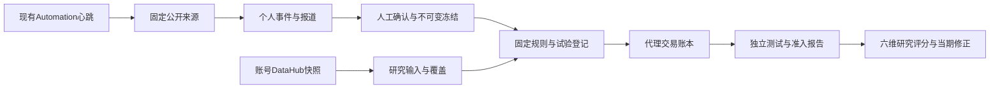

# 事件与日历研究集成合同

首批一次性公告与研究原值补齐展示范围；不执行历史试验、不封存正式总分，也不启用事件采集日程。

本模块实现用户2026-11-04批准的[实施计划](superpowers/plans/2026-11-04-events-calendar.md)。
当前候选仍处于实现与评审阶段，工程代码存在不等于来源、预测有效性、安装或部署验收。

## 分层

不新建AI研究引擎。解释性文字仍交给DSH。时间线位于研究情报，研究结果与评分证据位于策略
模拟；原境内ETF工程模拟不获得新的市场、策略或真实交易准入。

## 接口与使用

- `/api/research/events`：浏览、版本、确认/拒绝、合并/拆分、冻结、覆盖及固定来源任务。
- `/api/research/event-studies`：固定研究定义、预检、描述统计及封存后的一次性验证。
- `/api/research/event-studies/sources`：以当前账号原会话／数据集引用登记日线，不接收浏览器
  价格数组或PIT声明；`/calendar` 绑定已有原生交易日历和显式冻结的节假日定义。
- `/api/research/market-scores`：固定六维配置、研究分、来源及当期适用性；不启用生产总分。

所有写操作要求原账号认证、同源、`X-Research-User-Action: ?1`，并按接口使用请求标识与版本。
原件归档先于元数据引用；重新读取核验哈希和账号归属。过期、撤回、未知来源、缺失或更改的
原件不得升级为合格数据。

时间线的人工操作使用明确版本：

- 选择2至30项当前事件后，可展开合并表单填写新名称和理由；请求只携带选中事件的ID、
  版本及人工意图。合并保留父事件，新事件重新待确认。
- 事件详情可展开修订表单，编辑名称、类别、时间与精度、市场、生命周期和说明；通过
  `PATCH /events/{id}` 提交全部允许的事实字段、显示版本和理由。延期与取消是生命周期，
  与人工确认状态分别保存。
- 拆分表单创建两个子事件，分别核对名称与开始／结束时间，沿用父版本的类别、市场、
  生命周期、时间精度和说明；服务保留父事件及关联，两个子事件重新待确认。
- 版本历史与研究运行记录分别呈现。选择历史版本会明确请求 `?revision=`，历史详情只读；
  需重新读取当前版本后才能修订或拆分。历史页面展示该版本的发生、公开和取得时间，
  未知公开时间保持未知。

修订、拆分草稿按表单类型、事件ID和版本隔离；失败时保留输入，不把旧版本草稿自动填入
新版本。版本竞争或网络未知结果不会自动重发；相同明确操作保留原幂等标识。晚到的详情、
版本历史和写入响应均受视图／账号围栏约束。浏览器不能声明可信来源、历史可得性或准入。

## 数据与验证边界

DataHub价格登记保存原始字节和派生行映射，日期／单位／指数身份不明确时拒绝。只有实际观测
日线时，星期与月季年边界结果标记为观测日期口径，不能据此推断完整休市、半日市或节假日。
原生日历登记的标准开收盘时刻是明确假设，不冒充特殊交易时段的厂商或官方证明。

正式回测另需当时可知的逐版本日历、事件、代理、历史规则、公司行动和因子证据；日期存在和
人工确认不能给今日下载的数据补造PIT。真实来源尚未覆盖的市场、年份和指标保留缺口。
未配置或未通过的Host资格适配器应拒绝正式总分，不能由浏览器布尔值打开。

验证分开记录数据不合格、样本不足、验证失败及冻结版本通过。固定规则、训练证据、测试证据
和当前输入具有各自摘要；历史验证不等于因子在当前窗口适用，也不授权生产启用。

评分页仅将 `VALIDATED` 且角色匹配的记录列为基础评分或事件／日历修正证书，使用角色、指数
名称和版本区分。描述性研究、样本不足和失败记录的历史及拒绝原因仍在事件与日历研究中
查看；没有合格候选时明确显示空状态。列表筛选仅帮助人工选择，当前时点、冻结版本和来源
资格仍由服务端重新核验，不能因此启用正式评分。

## 持久化与运维

个人根含 `.event-timeline-initialized` 与 `event_timeline/`，涵盖事件、试验、日历、分数和
来源原件；新初始化懒执行，读请求不制造空库。保全沿既有维护／档案锁，备份和恢复核验归属、
完整性和原件；损坏或超限保留现场并拒绝，不能忽略或重置。来源计划默认关闭，调度只复用
Automation 心跳；失败/未知采集暂停，不在重启时自动重发未知结果。

本任务不会升级常驻服务、开启计划、调用付费模型或运行正式数据库迁移。实际命令、证据及
未完成项由[任务报告](../.ai/reports/2026-11-04-events-calendar.md)记录。
